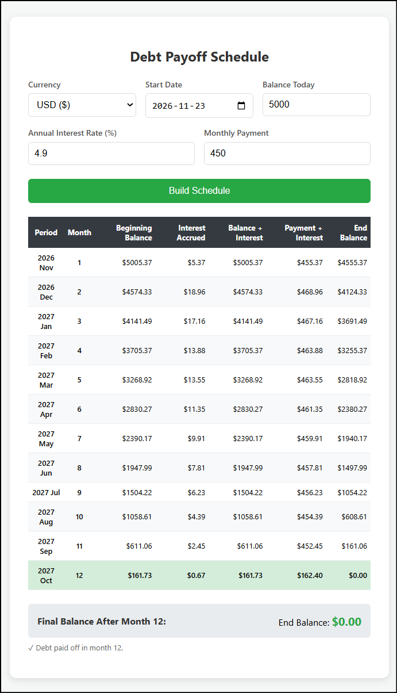
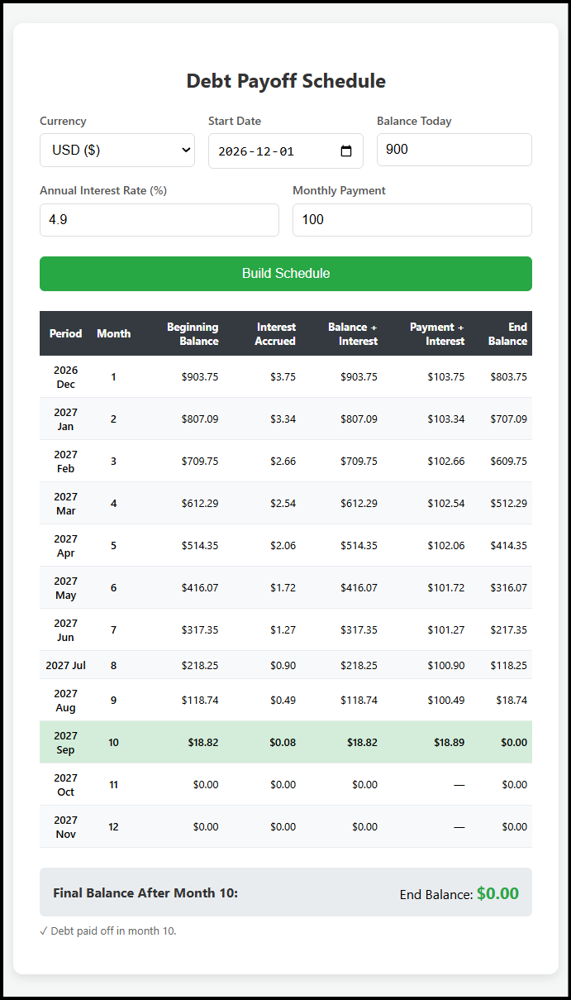

# Mission Control

Zero-State Projection — a single-file debt payoff calculator.

## Screenshots

## Features

- Daily-compounded interest (actual days per period)
- Auto-sizing schedule in 12-month increments (12 / 24 / 36 / 48 / 60)
- 9 currencies (USD, JPY, CNY, RUB, EUR, GBP, CAD, AUD, INR)
- Zero dependencies — one `index.html`, no build step
- Works offline

## Usage

Open `index.html` in any browser, or use the [live demo](https://enfren.github.io/debt-payoff-schedule/).

## Columns

| Column | Formula |
|--------|---------|
| Beginning Balance | Carry-forward (Month 1 = your input) |
| Interest Accrued | Beginning × (annual rate / 365) × days in period |
| Balance + Interest | Beginning + Interest |
| Payment + Interest | Fixed Payment + Interest |
| End Balance | Balance + Interest − Payment (floored at 0) |
